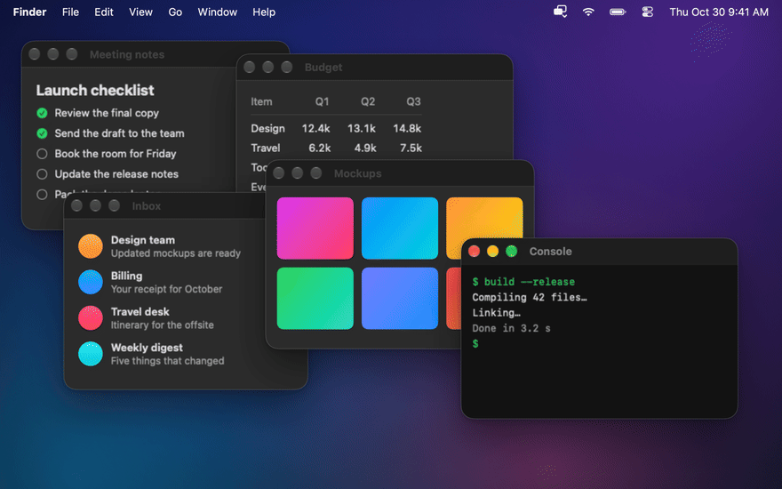
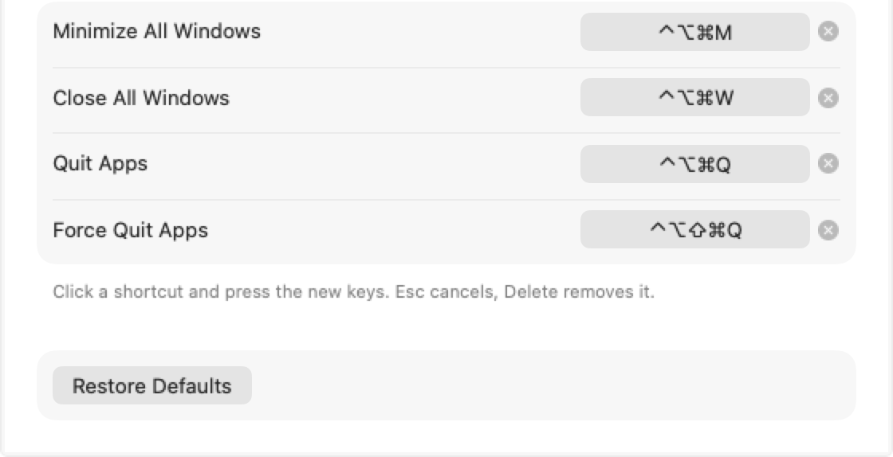

<div align="center">


# Window Organizer

### Clear the desk in one keystroke.

A small native **macOS** menu bar app that minimizes, closes, quits or force quits
all your open apps and windows at once, from global shortcuts. It is not an app switcher.

[](https://www.apple.com/macos/)
[](https://swift.org)
[](#requirements)
[](https://github.com/roypadina/window-organizer/releases/latest)
[](https://github.com/roypadina/homebrew-tap)
[](https://github.com/roypadina/window-organizer/actions/workflows/ci.yml)
[](https://apps.roypadina.synology.me/apps/window-organizer/)
[](LICENSE)
[](https://ko-fi.com/roypadina)
[](CONTRIBUTING.md)
[](https://github.com/roypadina/window-organizer/stargazers)

<br>



<br>

```bash
brew install --cask roypadina/tap/window-organizer
```



</div>

---

## Features

- **Minimize all windows** — every window of every targeted app goes to the Dock.
- **Close all windows** — presses each window's close button; apps keep running.
- **Quit apps** — asks every targeted app to quit normally (save dialogs still appear).
- **Force quit apps** — terminates targeted apps immediately, after a confirmation.
- **Global shortcuts** for all four actions: record any key combination in Settings, with live
  preview, conflict checks and a warning when another app already owns a shortcut.
- **App rules** — include or exclude any running app by bundle identifier. Finder, the Dock,
  System Settings, menu bar apps and Window Organizer itself are skipped by default.
  Search the running apps and filter by kind (Dock, menu bar, background), developer (Apple or
  third-party) and status (targeted, skipped, has a rule).
- **Action scope** — the windows on the current Space and displays (default), or all Spaces and displays.
- **Open at Login**, with the real system state shown in Settings. Window Organizer lives in the menu bar and has no Dock
  icon, except while Settings or About is open.
- **Welcome window** on first launch (and **Welcome Guide…** in Settings → General): what the app does, your shortcuts, the
  Accessibility step, and how to reach Settings if the menu bar icon is hidden. Open Window Organizer again from Applications or
  Raycast to get Settings.

## Requirements

macOS 14 Sonoma or later · Apple Silicon and Intel (universal binary)

## Install

```bash
brew install --cask roypadina/tap/window-organizer
```

**Not notarized.** Window Organizer is self-signed (no paid Apple Developer ID), so macOS may block the first launch. Open
**System Settings → Privacy & Security**, scroll down and click **Open Anyway** (right-click → Open no longer works on macOS 15+),
or clear quarantine once:

```bash
xattr -dr com.apple.quarantine "/Applications/Window Organizer.app"
```

Or download `Window-Organizer.zip` from the [latest release](https://github.com/roypadina/window-organizer/releases/latest),
unzip it and move `Window Organizer.app` to `/Applications`.

## Accessibility permission

Minimize and close use the macOS Accessibility API, so they need permission (quit and force quit do not):

1. Click the Window Organizer menu bar icon → **Grant Accessibility Access…** (shown until access is granted; a blocked Minimize
   or Close opens the same pane). Or use **Settings…** → **General** → **Grant Access…**.
2. Turn on **Window Organizer** in System Settings → Privacy & Security → Accessibility.

Since 0.2.0 releases are signed with the same certificate, so the grant survives updates.
Upgrading from 0.1.0, or still asked for access although it's on? Reset it once and grant again:

```bash
tccutil reset Accessibility com.padina.window-organizer
```

## Default shortcuts

| Shortcut | Action |
|---|---|
| `⌃⌥⌘M` | Minimize all windows |
| `⌃⌥⌘W` | Close all windows |
| `⌃⌥⌘Q` | Quit apps |
| `⌃⌥⌘⇧Q` | Force quit apps (asks first) |

Change them in **Settings… → Shortcuts**: click a shortcut and press the new keys (any key with ⌘, ⌃ or ⌥; F-keys work alone). Esc cancels, Delete removes it.
The menu bar menu has the same actions and shows your shortcuts next to them. **Settings…** is ⌘, and **Quit Window Organizer** is ⌘Q while the menu is open.

## Limitations

- **Current visible context is best effort.** macOS has no public API for full Space-level window control.
- Minimize and close only reach windows that apps expose through Accessibility.
- Quit can be interrupted by save dialogs and app confirmations; Window Organizer does not bypass them.
- **Force quit discards unsaved work.** It always asks for confirmation first.
- Some system and protected processes can't be quit.
- Not notarized (see [Install](#install)).

## Privacy

No network access, no analytics. Preferences are stored in the defaults domain `com.padina.window-organizer`.

## Build from source

Requires Xcode or the Xcode command line tools (Swift 6).

```bash
git clone https://github.com/roypadina/window-organizer.git
cd window-organizer
swift test
Scripts/package_app.sh            # writes dist/Window Organizer.app
open "dist/Window Organizer.app"
```

`RELEASE=1 Scripts/package_app.sh` also writes `dist/Window-Organizer.zip`.
`swift run WindowOrganizerApp` works for quick checks, but use the packaged app for real menu bar,
Accessibility and Launch at Login behavior. See [CONTRIBUTING.md](CONTRIBUTING.md) and the
[wiki](https://github.com/roypadina/window-organizer/wiki).

## Uninstall

```bash
brew uninstall --zap --cask window-organizer
```

Or quit it, drag `/Applications/Window Organizer.app` to the Trash, and remove it from Login Items.

## Feature requests and contributions

Have an idea for Window Organizer? [Request a feature](https://github.com/roypadina/window-organizer/issues/new?template=feature_request.yml) and say what you're trying to do; that matters more than the exact feature. Found a bug? [Report it](https://github.com/roypadina/window-organizer/issues/new?template=bug_report.yml).

Code is welcome too: small, focused pull requests, and an issue first for anything bigger. See [CONTRIBUTING.md](CONTRIBUTING.md).

Tipped on [Ko-fi](https://ko-fi.com/roypadina)? Add your Ko-fi name to the request and it goes to the front of my queue. It's a thank-you, not a purchase: no promise on what ships or when.

## More Mac apps by Roy

Free, open-source Mac menu-bar apps and terminal tools, all on one site: **[apps.roypadina.synology.me](https://apps.roypadina.synology.me/)**.

- [LanGuard](https://apps.roypadina.synology.me/apps/languard/) — Wi-Fi off when you're wired. Back on when you're not.
- [SmartHiddenBar](https://apps.roypadina.synology.me/apps/smarthiddenbar/) — Hide the menu bar clutter. Reach it in one click.
- [VaultBar](https://apps.roypadina.synology.me/apps/vaultbar/) — Your encrypted vaults, one click from the menu bar.
- [MeetAlert](https://apps.roypadina.synology.me/apps/meetalert/) — Meeting alerts you can't miss: a popup that stays, a phone push that escalates.
- [PullPing](https://apps.roypadina.synology.me/apps/pullping/) — Know when your pull requests need you, across every GitHub account.

## Support

If Window Organizer clears your desktop in one keystroke, you can support its development — it's optional and always appreciated.

[](https://ko-fi.com/roypadina)

A ⭐ on the repo helps just as much.

## License

[MIT](LICENSE) © Roy Padina
